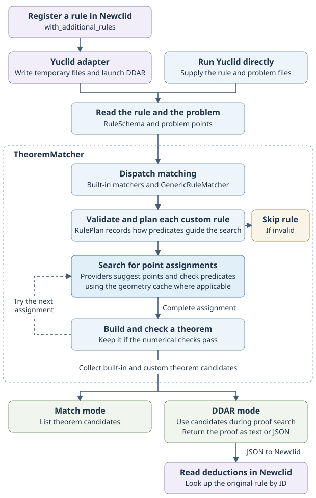

Custom-rule architecture
========================

A custom rule tells Yuclid what it can conclude from a premise. If
``M`` is the midpoint of ``AB``, for example, then ``AM`` and ``MB`` have
equal length. The same rule can be used with different points.

         matching flow. Match mode lists candidates. DDAR produces proof
         deductions that the Python adapter can read.
   :align: center

   Start at either input at the top. The dotted outline marks the work
   done by ``TheoremMatcher``, including the search it delegates to
   ``GenericRuleMatcher``. The dashed arrow shows where search loops back.

Send a rule to Yuclid
---------------------

If you run Yuclid directly, you supply the rule file and the problem file.
When you register a rule in Newclid with ``with_additional_rules``, the
Python adapter prepares constants, writes both files to a temporary
directory, and launches Yuclid in ``ddar`` mode with JSON output.
See :doc:`setup` for examples of both entry points.

Read the rule and the problem
-----------------------------

The two entry points meet at the same parsers. The rule parser reads a
block like this into a ``RuleSchema``:

.. code-block:: text

   rule midpoint_equal_lengths A B M
   require midp M A B
   conclude cong A M M B
   end

The schema holds the rule ID, the declared variables, and the predicate
patterns from the ``require`` and ``conclude`` lines. At this point
``A``, ``B``, and ``M`` are still placeholders. The problem parser, meanwhile,
reads the actual points, their coordinates, the assumptions, and the goals.
For this example, suppose it reads ``a = (0, 0)``, ``m = (1, 0)``, and
``b = (2, 0)``.

Dispatch matching and plan each rule
------------------------------------

``TheoremMatcher`` runs the built-in matchers and hands the custom schemas
to ``GenericRuleMatcher``. The generic matcher checks each schema for problems
such as undeclared variables or the wrong number of predicate arguments.
It skips rules that fail validation and logs a warning.

For each rule it can search, the matcher builds a ``RulePlan``. The plan
records which variables each predicate uses, the role it plays in the
search, and its base cost. As points are assigned, the matcher uses the
roles and current cost estimates to decide which predicate to use next.

Both sides of the rule can guide the search. In this example,
``cong A M M B`` is a *generator*, so the matcher uses the equal-length
conclusion to find points. Then ``midp M A B``, a *validator*, checks
whether those points form a midpoint. The rule still applies in the
direction written in the file when the solver uses it in a proof.

Search for point assignments
----------------------------

Providers suggest points for the rule's variables. Some providers use a
shared geometry cache to speed up the search. The matcher checks each
suggestion and tries another if a check fails.

Here the congruence provider can suggest an assignment for all three
variables at once. With ``A → a``, ``B → b``, and ``M → m``, the two
segments have equal length, and the midpoint check also passes. In a
larger rule, the matcher may fill the variables over several steps.
Each sequence of choices is a *branch*. The matcher can return to an
earlier choice and try a different point assignment.

See :doc:`concepts` for how assignments are represented and
:doc:`matching` for how the search proceeds.

Build and check a theorem
-------------------------

Once every variable has a point, the statement builder creates the
concrete premise and conclusion. The theorem builder combines them into
a ``Theorem`` with the original rule ID. This assignment gives:

.. code-block:: text

   midp m a b → cong a m m b

Yuclid verifies that the premises are nondegenerate and that both sides
agree with the coordinates. It normalizes and keeps candidates that pass,
then continues searching for other assignments. When matching finishes,
``TheoremMatcher`` collects the custom candidates with the built-in ones.

List candidates or use them in a proof
--------------------------------------

In ``match`` mode, Yuclid prints the candidate list. In ``ddar`` mode, the
solver records the problem's assumptions and loads the candidates during
initialization. To use the midpoint candidate, it needs ``midp m a b``
from an assumption or an earlier deduction. Once that premise is
established, the candidate can justify ``cong a m m b``. The coordinate
checks explain why the candidate is available. The established premise
is what lets the solver apply it.

Yuclid returns the proof as text or JSON. On the Newclid path, the
adapter reads the JSON and looks up each custom rule deduction's original
Python rule by ID. Newclid can follow that deduction and add the conclusion
to its own proof state once the premises are established.
