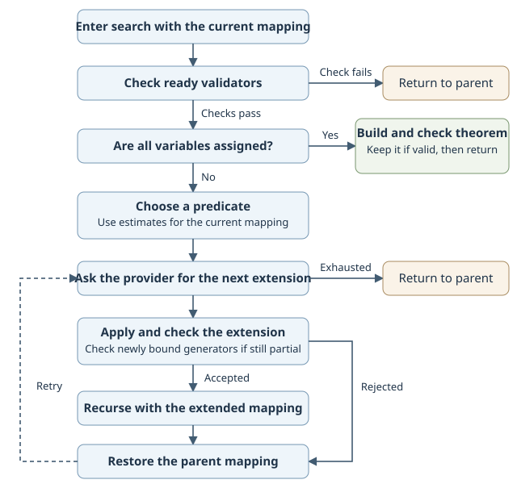
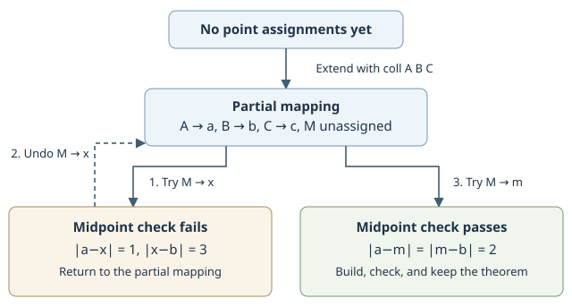

Matching a custom rule
======================

``GenericRuleMatcher::optimized_match`` searches for point assignments
that make a rule's predicates true on the figure. The variables and
predicates form a constraint satisfaction problem (CSP). The matcher
uses depth-first search (DFS), exploring one sequence of assignments
at a time and undoing choices as it returns to an earlier step.

See :doc:`architecture` for how the resulting candidates reach proof search
and :doc:`concepts` for the rule and mapping representations.

The search loop
---------------

         theorem for a complete mapping or selects a predicate and tries
         extensions. Each attempted extension returns to its parent state.
   :align: center

   A search call handles one partial or complete mapping. Its parent
   can resume trying extensions after the call returns.

1. **Check ready validators.** At the start of a call, the matcher checks
   validators whose variables all have points and whose checks have yet
   to pass on this branch. A failed check ends the call. ``FilterState``
   records the checks that passed, so deeper calls can reuse them.
2. **Handle a complete mapping.** If all variables have points, the
   matcher builds the theorem, checks premise non-degeneracy and the
   numerical validity of both sides, and keeps the normalized theorem
   if it passes. This ends the call.
3. **Choose a predicate to extend the mapping.** The matcher asks providers
   to estimate how many extensions their predicates may yield, given the
   current assignments. It chooses the eligible generator with the
   smallest estimate, considering validators as a fallback if no
   generator can extend the mapping. This choice is made again on each
   call that needs more points.
4. **Try extensions one at a time.** The chosen provider yields extensions
   through ``std::generator``. An extension can fill several variables.
   ``MappingState`` checks that it preserves existing assignments and
   keeps points distinct across variables. If the mapping is still
   partial, the matcher checks generators whose last missing variable
   was just assigned. This includes generators other than the one
   selected. A complete mapping goes straight to a new search call for
   validator checks and theorem validation.
5. **Restore and continue.** After a rejected extension or a recursive
   call, the matcher can try the next extension from the same parent
   mapping. Snapshots let it undo point assignments and validator
   checks at the appropriate search level.

A predicate's role controls when search uses it. Its provider controls
how it generates extensions or checks geometry. For example, ``coll``
is a generator that uses ``BaseProvider``, which enumerates assignments
before the matcher checks collinearity. ``cong`` has a specialized
provider. See :doc:`providers` for the provider interface.

``CandidateFilter`` is a separate reserved role. Current custom rules
use generators and validators, and search does not process the plan's
``candidate_filters`` list. ``FilterState`` tracks validator checks.

Backtracking through an example
-------------------------------

This rule says that if ``M`` is the midpoint of ``AB`` and ``C`` lies on
the line through ``A`` and ``B``, then ``A``, ``M``, and ``C`` are collinear.

.. code-block:: text

   rule midpoint_on_line A B C M
   require coll A B C
   require midp M A B
   conclude coll A M C
   end

Take five points on the horizontal axis: ``a = (0, 0)``, ``b = (4, 0)``,
``c = (6, 0)``, ``x = (1, 0)``, and ``m = (2, 0)``. The diagram
shows two attempts from the same partial mapping. The order of the
attempts is illustrative.

         and C to c. Trying M as x fails the midpoint check. The matcher
         returns to that partial mapping and tries M as m, which yields a
         theorem candidate.
   :align: center

   Backtracking restores the parent mapping. Both attempts reuse
   ``A → a``, ``B → b``, and ``C → c``.

At the start, the two ``coll`` generators have the same estimate. The
matcher uses the first, ``coll A B C``. For the assignment ``A → a``,
``B → b``, and ``C → c``, the collinearity check passes. The matcher
then uses the remaining generator, ``coll A M C``, to suggest a point
for ``M``.

Trying ``M → x`` makes the conclusion collinear, but ``x`` is a unit from
``a`` and three units from ``b``. The midpoint validator rejects this
mapping before theorem construction. The matcher undoes ``M → x``
and can try ``M → m`` with the same other assignments. Both distances
are then two units, and the complete theorem passes validation.

The matcher stores that candidate and continues with other suggestions.
Once it runs out of extensions from the current partial mapping, it
backs up another level and tries a different assignment for
``A``, ``B``, and ``C``.

Candidates and proof search
---------------------------

Each complete mapping is checked as soon as the matcher reaches it. The
result list holds accepted theorems, so a rule with many valid instances
can still require substantial memory. Normalization puts equivalent
statements into a common form. Different mappings can still yield
equivalent entries.

Numerical checks decide which candidates reach DDAR. To apply a candidate
in a proof, DDAR needs established hypotheses. Custom rules are trusted
inferences.

``GenericRuleMatcher::match`` provides a naive reference for comparing
results on small problems.
